<p align="center">
  <a href="https://hotelcorporatecodes.com">
    <picture>
      <source media="(prefers-color-scheme: dark)" srcset="assets/hero-dark.svg">
      
    </picture>
  </a>
</p>

<p align="center">
  <a href="https://www.npmjs.com/package/@adsorgcn/hotel-corporate-codes"></a>
  <a href="https://github.com/adsorgcn/hotel-corporate-codes/releases"></a>
  <a href="LICENSE"></a>
  <a href="https://hotelcorporatecodes.com"></a>
  <a href="https://www.youtube.com/@hotelcorporatecodes"></a>
</p>

<p align="center">
  The reference dataset behind <a href="https://hotelcorporatecodes.com">hotelcorporatecodes.com</a>.<br>
  Every record is a company's corporate rate code for a hotel group, as plain JSON you can <code>require()</code>.<br>
  Unknown values stay <code>null</code>. Nothing is invented to fill a cell.<br>
  <sub>The original HotelCorporateCodes.com. Independent, not affiliated with any hotel group.</sub>
</p>

<br>

<!-- stats:start -->

<table align="center">
  <tr>
    <td align="center"><h3>290</h3><sub>hotel codes</sub></td>
    <td align="center"><h3>10</h3><sub>hotel groups</sub></td>
    <td align="center"><h3>127</h3><sub>reported ranges</sub></td>
    <td align="center"><h3>4</h3><sub>official sources</sub></td>
    <td align="center"><h3>5</h3><sub>car-rental deals</sub></td>
  </tr>
</table>

<!-- stats:end -->

<br>

## Use it in ten seconds

```bash
npm install @adsorgcn/hotel-corporate-codes
```

```js
const codes = require('@adsorgcn/hotel-corporate-codes');

codes.findByCode('000243132');     // [{ brand: 'ihg', company: 'IBM', … }]
codes.searchByCompany('siemens');  // Siemens at seven hotel groups
codes.getBrand('hyatt');           // the 18 Hyatt records
codes.totalCodes;                  // 290
```

Just browsing? [hotelcorporatecodes.com](https://hotelcorporatecodes.com) renders this data with booking steps per brand, and its assistant answers questions about eligibility.

<br>

## What a record looks like

```json
{
  "code": "SIE",
  "company": "Siemens",
  "discount": "15-22%",
  "region": "Global",
  "idRequired": "Rarely",
  "note": "Best overall. Personal travel allowed.",
  "verified": "2026-03"
}
```

| Field | Meaning |
|:------|:--------|
| `code` | The string you type on the hotel site, leading zeros included. Always present, always a string. |
| `company` | The organisation the agreement belongs to. Always present. |
| `discount` | Range travellers reported, e.g. `10-15%`. A report, not a promise. `null` until someone reports one. |
| `region` | Where the agreement is known to apply. `null` when unknown. |
| `idRequired` | How often travellers were asked for proof of eligibility. `null` when unknown. |
| `note` | Free text from the original record; an empty string when there is none. |
| `verified` | Month a traveller last confirmed the code worked, `YYYY-MM`. `null` when never confirmed. |
| `source` | Page that publishes the code. Only present on sourced records. |

Files: one JSON array per hotel group in [`data/`](data/), plus [`data/car-rental.json`](data/car-rental.json). The npm package ships exactly those files and [`index.js`](index.js); no build step, no dependencies.

<br>

## The codes

Ten hotel groups, one table each. Codes shown **bold** carry a reported discount range; the rest are known agreements with no range on file. The last column links to the brand's official page when we have one (*official*), or to the record's page on the site (*site*).

<!-- codes:start -->

| Hotel group | Codes | With reported discount | Where the code goes on the brand site |
|:------------|------:|-----------------------:|:--------------------------------------|
| [Marriott Bonvoy](#marriott-bonvoy-127-codes) | **127** | 63 | [marriott.com](https://www.marriott.com) → Special Rates → Corporate/Promo Code |
| [Hilton Honors](#hilton-honors-51-codes) | **51** | 19 | [hilton.com](https://www.hilton.com) → Special Rates → Corporate Account |
| [IHG One Rewards](#ihg-one-rewards-29-codes) | **29** | 25 | [ihg.com](https://www.ihg.com) → Rate Preference → Corporate ID |
| [World of Hyatt](#world-of-hyatt-18-codes) | **18** | 9 | [hyatt.com](https://www.hyatt.com) → Special Rates → Corporate or Group Code |
| [Wyndham Rewards](#wyndham-rewards-16-codes) | **16** | 6 | [wyndhamhotels.com](https://www.wyndhamhotels.com) → Special Rates → Corporate Code |
| [Radisson Rewards](#radisson-rewards-30-codes) | **30** | 0 | [radissonhotels.com](https://www.radissonhotels.com) → Corporate account number |
| [Best Western Rewards](#best-western-rewards-11-codes) | **11** | 2 | [bestwestern.com](https://www.bestwestern.com) → Special Rate → Corporate ID |
| [Choice Privileges](#choice-privileges-6-codes) | **6** | 2 | [choicehotels.com](https://www.choicehotels.com) → Special Rate → Client ID |
| [Accor ALL](#accor-all-1-code) | **1** | 1 | [all.accor.com](https://all.accor.com) → Preferential code |
| [Omni Select Guest](#omni-select-guest-1-code) | **1** | 0 | [omnihotels.com](https://www.omnihotels.com) → Corporate ID |

### Marriott Bonvoy (127 codes)

Enter the code at [marriott.com](https://www.marriott.com) → Special Rates → Corporate/Promo Code.

<details>
<summary>Show all 127 codes</summary>

| Code | Company | Discount | Region | ID check | Source |
|:-----|:--------|:---------|:-------|:---------|:------:|
| **`SIE`** | Siemens | 15-22% | Global | ✅ Rarely |  |
| **`IBM`** | IBM | 10-18% | Global | ⚠️ Sometimes |  |
| **`ACC`** | Accenture | 12-20% | NA+EU | ✅ Rarely |  |
| **`DEL`** | Dell | 10-15% | Global | ⚠️ Sometimes |  |
| **`DTC`** | Deloitte | 10-18% | Global | ⚠️ Sometimes |  |
| **`EYC`** | Ernst & Young | 10-18% | Global | ⚠️ Sometimes |  |
| **`GEE`** | General Electric | 12-18% | Global | ✅ Rarely |  |
| **`GGL`** | Google | 10-18% | Global | ⚠️ Sometimes |  |
| **`APL`** | Apple | 10-15% | Global | ⚠️ Sometimes |  |
| **`APC`** | Apple (alt) | 10-15% | Global | ⚠️ Sometimes |  |
| **`MCO`** | Microsoft | 10-18% | Global | ⚠️ Sometimes |  |
| **`ORA`** | Oracle | 10-15% | Global | ⚠️ Sometimes |  |
| **`SAP`** | SAP | 12-18% | EU+NA | ✅ Rarely |  |
| **`CIS`** | Cisco | 10-15% | Global | ⚠️ Sometimes |  |
| **`HPQ`** | HP | 10-15% | Global | ⚠️ Sometimes |  |
| **`IBS`** | Intel | 10-15% | Global | ⚠️ Sometimes |  |
| **`ATT`** | AT&T | 10-15% | NA | ⚠️ Sometimes |  |
| **`FSF`** | Facebook/Meta | 10-15% | Global | ⚠️ Sometimes |  |
| **`QUA`** | Qualcomm | 10-15% | NA | ✅ Rarely |  |
| **`BOA`** | Bank of America | 10-15% | NA | ⚠️ Sometimes |  |
| **`JPM`** | JP Morgan Chase | 10-18% | Global | ⚠️ Sometimes |  |
| **`CIT`** | Citigroup | 10-15% | Global | ⚠️ Sometimes |  |
| **`HSB`** | HSBC | 10-15% | Global | ⚠️ Sometimes |  |
| **`UBS`** | UBS | 10-15% | Global | ⚠️ Sometimes |  |
| **`AMX`** | American Express | 10-15% | Global | ⚠️ Sometimes |  |
| **`MOS`** | Morgan Stanley | 10-15% | Global | ⚠️ Sometimes |  |
| **`DBK`** | Deutsche Bank | 10-15% | EU+NA | ⚠️ Sometimes |  |
| **`VSA`** | VISA | 10-15% | Global | ⚠️ Sometimes |  |
| **`PRU`** | Prudential | 10-15% | NA | ⚠️ Sometimes |  |
| **`PEP`** | PepsiCo | 10-15% | NA | ✅ Rarely |  |
| **`COK`** | Coca-Cola | 10-15% | Global | ✅ Rarely |  |
| **`PAG`** | Procter & Gamble | 10-16% | Global | ⚠️ Sometimes |  |
| **`NKE`** | Nike | 10-15% | NA | ✅ Rarely |  |
| **`DIS`** | Disney | 10-15% | NA | ⚠️ Sometimes |  |
| **`GAP`** | GAP Inc | 10-15% | NA | ✅ Rarely |  |
| **`MCD`** | McDonald's | 10-15% | NA | ✅ Rarely |  |
| **`JOH`** | Johnson & Johnson | 10-15% | Global | ⚠️ Sometimes |  |
| **`PFZ`** | Pfizer | 10-15% | Global | ⚠️ Sometimes |  |
| **`MMM`** | 3M | 10-15% | Global | ✅ Rarely |  |
| **`SHL`** | Shell | 10-15% | Global | ⚠️ Sometimes |  |
| **`PHI`** | Philips | 10-15% | EU+NA | ✅ Rarely |  |
| **`TSN`** | ThyssenKrupp | 10-15% | EU | ✅ Rarely |  |
| **`MLM`** | Bayer | 10-15% | EU+NA | ✅ Rarely |  |
| **`WEL`** | Wells Fargo | 10-15% | NA | ⚠️ Sometimes |  |
| **`FDS`** | Macy's | 10-15% | NA | ✅ Rarely |  |
| **`PCW`** | PwC | 10-15% | Global | ⚠️ Sometimes |  |
| **`SON`** | Sony | 10-15% | Global | ⚠️ Sometimes |  |
| **`TOS`** | Toshiba | 10-15% | Asia | ✅ Rarely |  |
| **`TOY`** | Toyota | 10-15% | Global | ⚠️ Sometimes |  |
| **`FRD`** | Ford | 10-15% | NA | ⚠️ Sometimes |  |
| **`NIS`** | Nissan | 10-15% | Global | ⚠️ Sometimes |  |
| **`GMC`** | General Motors | 10-15% | NA | ⚠️ Sometimes |  |
| **`DCX`** | DaimlerChrysler | 10-15% | EU+NA | ⚠️ Sometimes |  |
| **`DLA`** | Delta Airlines | 10-15% | NA | ⚠️ Sometimes |  |
| **`UAL`** | United Airlines | 10-15% | NA | ⚠️ Sometimes |  |
| **`LHS`** | Lufthansa M&M Elite | 10-15% | EU | ⚠️ Sometimes |  |
| **`FED`** | FedEx | 10-15% | Global | ⚠️ Sometimes |  |
| **`A7A`** | Alibaba | 10-20% | Asia | ⚠️ Sometimes |  |
| **`MEB`** | eBreaks Weekend | 20% weekends | NA only | ✅ No |  |
| **`OXD`** | Student (Enactus) | ¥400/night | China select | ✅ No |  |
| **`LPR`** | Local Promo Rate | Varies | Varies | ✅ No |  |
| **`AAA`** | AAA | 5-15% | NA | AAA card |  |
| **`GOV`** | US Government | Per diem | US | Govt ID |  |
| `ATK` | A.T. Kearney | — | Global | — | [site ↗](https://hotelcorporatecodes.com/codes/marriott-at-kearney) |
| `AET` | Aetna | — | NA | — | [site ↗](https://hotelcorporatecodes.com/codes/marriott-aetna) |
| `AIG` | AIG | — | Global | — | [site ↗](https://hotelcorporatecodes.com/codes/marriott-aig) |
| `A70` | Alaska Airlines | — | NA | — | [site ↗](https://hotelcorporatecodes.com/codes/marriott-alaska-airlines) |
| `ALL` | Allstate | — | NA | — | [site ↗](https://hotelcorporatecodes.com/codes/marriott-allstate) |
| `AA8` | American Airlines | — | NA | — | [site ↗](https://hotelcorporatecodes.com/codes/marriott-american-airlines) |
| `AFI` | American Family Insurance | — | NA | — | [site ↗](https://hotelcorporatecodes.com/codes/marriott-american-family-insurance) |
| `AMW` | Amway | — | NA | — | [site ↗](https://hotelcorporatecodes.com/codes/marriott-amway) |
| `AOL` | AOL | — | NA | — | [site ↗](https://hotelcorporatecodes.com/codes/marriott-aol) |
| `253568` | APAC | — | Asia | — | [site ↗](https://hotelcorporatecodes.com/codes/marriott-apac) |
| `APP` | Applied Materials | — | NA | — | [site ↗](https://hotelcorporatecodes.com/codes/marriott-applied-materials) |
| `BOB` | Bank One | — | NA | — | [site ↗](https://hotelcorporatecodes.com/codes/marriott-bank-one) |
| `BEC` | Bechtel | — | Global | — | [site ↗](https://hotelcorporatecodes.com/codes/marriott-bechtel) |
| `256810` | BellSouth | — | NA | — | [site ↗](https://hotelcorporatecodes.com/codes/marriott-bellsouth) |
| `BAR` | Best Available Rate | — | Global | — | [site ↗](https://hotelcorporatecodes.com/codes/marriott-best-available-rate) |
| `340965` | BlackRock | — | Global | — | [site ↗](https://hotelcorporatecodes.com/codes/marriott-blackrock) |
| `5298` | BMS | — | NA | — | [site ↗](https://hotelcorporatecodes.com/codes/marriott-bms) |
| `BMW` | BMW | — | Global | — | [site ↗](https://hotelcorporatecodes.com/codes/marriott-bmw) |
| `5171` | Boeing | — | NA | — | [site ↗](https://hotelcorporatecodes.com/codes/marriott-boeing) |
| `CDH` | Cardinal Health | — | NA | — | [site ↗](https://hotelcorporatecodes.com/codes/marriott-cardinal-health) |
| `CFA` | Chick-fil-A | — | NA | — | [site ↗](https://hotelcorporatecodes.com/codes/marriott-chick-fil-a) |
| `CLX` | Clorox | — | NA | — | [site ↗](https://hotelcorporatecodes.com/codes/marriott-clorox) |
| `CVG` | Convergys | — | NA | — | [site ↗](https://hotelcorporatecodes.com/codes/marriott-convergys) |
| `281403` | CPI | — | NA | — | [site ↗](https://hotelcorporatecodes.com/codes/marriott-cpi) |
| `283335` | CVS | — | NA | — | [site ↗](https://hotelcorporatecodes.com/codes/marriott-cvs) |
| `D86` | De Beers | — | Global | — | [site ↗](https://hotelcorporatecodes.com/codes/marriott-de-beers) |
| `11353` | Deutsche Bahn | — | EU | — | [site ↗](https://hotelcorporatecodes.com/codes/marriott-deutsche-bahn) |
| `2754` | DirecTV | — | NA | — | [site ↗](https://hotelcorporatecodes.com/codes/marriott-directv) |
| `253511` | E&Y (alt) | — | Global | — | [site ↗](https://hotelcorporatecodes.com/codes/marriott-ey-alt) |
| `EDD` | Eddie Bauer | — | NA | — | [site ↗](https://hotelcorporatecodes.com/codes/marriott-eddie-bauer) |
| `EDS` | Electronic Data Systems | — | NA | — | [site ↗](https://hotelcorporatecodes.com/codes/marriott-electronic-data-systems) |
| `EMC` | EMC | — | NA | — | [site ↗](https://hotelcorporatecodes.com/codes/marriott-emc) |
| `XOM` | ExxonMobil | — | Global | — | [site ↗](https://hotelcorporatecodes.com/codes/marriott-exxonmobil) |
| `295936` | Fed Rooms | — | US | — | [site ↗](https://hotelcorporatecodes.com/codes/marriott-fed-rooms) |
| `66272` | Federated | — | NA | — | [site ↗](https://hotelcorporatecodes.com/codes/marriott-federated) |
| `FUS` | First USA | — | NA | — | [site ↗](https://hotelcorporatecodes.com/codes/marriott-first-usa) |
| `FLT` | Fleet Bank | — | NA | — | [site ↗](https://hotelcorporatecodes.com/codes/marriott-fleet-bank) |
| `FPL` | Florida Power | — | NA | — | [site ↗](https://hotelcorporatecodes.com/codes/marriott-florida-power) |
| `FUJ` | Fuji | — | Asia | — | [site ↗](https://hotelcorporatecodes.com/codes/marriott-fuji) |
| `9360` | GE (alt) | — | Global | — | [site ↗](https://hotelcorporatecodes.com/codes/marriott-ge-alt) |
| `G2D` | General Dynamics | — | NA | — | [site ↗](https://hotelcorporatecodes.com/codes/marriott-general-dynamics) |
| `4764` | Gillette | — | NA | — | [site ↗](https://hotelcorporatecodes.com/codes/marriott-gillette) |
| `254797` | Goldman Sachs | — | Global | — | [site ↗](https://hotelcorporatecodes.com/codes/marriott-goldman-sachs) |
| `17885` | Harvard University | — | NA | — | [site ↗](https://hotelcorporatecodes.com/codes/marriott-harvard-university) |
| `5444` | HP (alt 2) | — | Global | — | [site ↗](https://hotelcorporatecodes.com/codes/marriott-hp-alt-2) |
| `5105` | HP (alt) | — | Global | — | [site ↗](https://hotelcorporatecodes.com/codes/marriott-hp-alt) |
| `290717` | IIDA | — | NA | — | [site ↗](https://hotelcorporatecodes.com/codes/marriott-iida) |
| `INL` | Intel (alt) | — | Global | — | [site ↗](https://hotelcorporatecodes.com/codes/marriott-intel-alt) |
| `10053` | Intuitive Surgical | — | NA | — | [site ↗](https://hotelcorporatecodes.com/codes/marriott-intuitive-surgical) |
| `JCP` | JC Penney | — | NA | — | [site ↗](https://hotelcorporatecodes.com/codes/marriott-jc-penney) |
| `KRO` | Kroger | — | NA | — | [site ↗](https://hotelcorporatecodes.com/codes/marriott-kroger) |
| `LGM` | Legg Mason | — | NA | — | [site ↗](https://hotelcorporatecodes.com/codes/marriott-legg-mason) |
| `LOW` | Lowe's | — | NA | — | [site ↗](https://hotelcorporatecodes.com/codes/marriott-lowes) |
| `256547` | LVMH | — | Global | — | [site ↗](https://hotelcorporatecodes.com/codes/marriott-lvmh) |
| `MAA` | Manhattan Associates | — | NA | — | [site ↗](https://hotelcorporatecodes.com/codes/marriott-manhattan-associates) |
| `MMP` | Marriott Explore | — | Global | — | [site ↗](https://hotelcorporatecodes.com/codes/marriott-marriott-explore) |
| `363006` | MIT | — | NA | — | [site ↗](https://hotelcorporatecodes.com/codes/marriott-mit) |
| `59009` | Morgan Stanley (alt) | — | Global | — | [site ↗](https://hotelcorporatecodes.com/codes/marriott-morgan-stanley-alt) |
| `NCY` | National City Bank | — | NA | — | [site ↗](https://hotelcorporatecodes.com/codes/marriott-national-city-bank) |
| `NOR` | Northrop Grumman | — | NA | — | [site ↗](https://hotelcorporatecodes.com/codes/marriott-northrop-grumman) |
| `NOV` | Novell | — | NA | — | [site ↗](https://hotelcorporatecodes.com/codes/marriott-novell) |
| `NVL` | Novellus | — | NA | — | [site ↗](https://hotelcorporatecodes.com/codes/marriott-novellus) |
| `77377` | Oracle (alt) | — | Global | — | [site ↗](https://hotelcorporatecodes.com/codes/marriott-oracle-alt) |
| `PFE` | Pfizer (alt) | — | Global | — | [site ↗](https://hotelcorporatecodes.com/codes/marriott-pfizer-alt) |

</details>

### Hilton Honors (51 codes)

Enter the code at [hilton.com](https://www.hilton.com) → Special Rates → Corporate Account. Hilton also publishes company-specific booking pages at `hilton.com/en/preferred-rates/{company}/`.

<details>
<summary>Show all 51 codes</summary>

| Code | Company | Discount | Region | ID check | Source |
|:-----|:--------|:---------|:-------|:---------|:------:|
| **`302844100`** | Siemens T1 | 10-15% | Global | ✅ No |  |
| **`N0079268`** | Siemens Premium | 12-18% | Global | ✅ No |  |
| **`D323009803`** | Siemens Intl | 10-15% | International | ✅ No |  |
| **`0041604`** | MVP | 15-20% | Global | ⚠️ May ask |  |
| **`N0001231`** | FedEx | 10% | Global | ⚠️ Sometimes |  |
| **`0560054725`** | Team USA | 10-15% | US | ✅ No |  |
| **`N9880578`** | Blackstone | 12-18% | US | ✅ Rarely |  |
| **`0901452`** | IBM (US) | 10-15% | US | ⚠️ Sometimes |  |
| **`001368083`** | IBM (Intl) | 10-15% | International | ⚠️ Sometimes |  |
| **`9122532`** | HP | 10-15% | Global | ⚠️ Sometimes |  |
| **`0001398`** | GE | 10-15% | Global | ⚠️ Sometimes |  |
| **`0072799100`** | GE (alt) | 10-15% | Global | ⚠️ Sometimes |  |
| **`402371223`** | Akzo Nobel | 10-15% | Global | ✅ Rarely |  |
| **`355019365`** | Volvo | 10-15% | Global | ✅ Rarely |  |
| **`10850857`** | Accenture | 10-18% | Global | ⚠️ Sometimes |  |
| **`0002544270`** | Oracle | 10-15% | Global | ⚠️ Sometimes |  |
| **`8122`** | Ford | 10-15% | NA | ⚠️ Sometimes |  |
| **`N0710081`** | Bank of America | 10-15% | NA | ⚠️ Sometimes |  |
| **`AAA`** | AAA | 5-15% | NA | AAA card |  |
| `N0001542` | 3M | — | Global | — | [site ↗](https://hotelcorporatecodes.com/codes/hilton-3m) |
| `N0156333` | Accenture (alt) | — | Global | — | [site ↗](https://hotelcorporatecodes.com/codes/hilton-accenture-alt) |
| `N0000046` | AT&T | — | NA | — | [site ↗](https://hotelcorporatecodes.com/codes/hilton-att) |
| `N0001125` | BASF | — | Global | — | [site ↗](https://hotelcorporatecodes.com/codes/hilton-basf) |
| `N0437015` | Berkshire Hathaway | — | Global | — | [site ↗](https://hotelcorporatecodes.com/codes/hilton-berkshire-hathaway) |
| `N2728493` | BP | — | Global | — | [site ↗](https://hotelcorporatecodes.com/codes/hilton-bp) |
| `N0990552` | CapGemini | — | Global | — | [site ↗](https://hotelcorporatecodes.com/codes/hilton-capgemini) |
| `N0001420` | Coca-Cola | — | Global | — | [site ↗](https://hotelcorporatecodes.com/codes/hilton-coca-cola) |
| `N7654328` | Dell | — | Global | — | [site ↗](https://hotelcorporatecodes.com/codes/hilton-dell) |
| `601560` | Deloitte | — | Global | — | [site ↗](https://hotelcorporatecodes.com/codes/hilton-deloitte) |
| `N0997136` | Disney | — | NA | — | [site ↗](https://hotelcorporatecodes.com/codes/hilton-disney) |
| `N0990214` | Dow Chemical | — | NA | — | [site ↗](https://hotelcorporatecodes.com/codes/hilton-dow-chemical) |
| `D600198360` | FFEIE | — | Global | — | [site ↗](https://hotelcorporatecodes.com/codes/hilton-ffeie) |
| `N2674000` | Fiat Chrysler | — | NA | — | [site ↗](https://hotelcorporatecodes.com/codes/hilton-fiat-chrysler) |
| `N0900266` | Ford (alt) | — | NA | — | [site ↗](https://hotelcorporatecodes.com/codes/hilton-ford-alt) |
| `N0903395` | General Motors | — | NA | — | [site ↗](https://hotelcorporatecodes.com/codes/hilton-general-motors) |
| `N3846652` | Harley-Davidson | — | NA | — | [site ↗](https://hotelcorporatecodes.com/codes/hilton-harley-davidson) |
| `N0794705` | Home Depot | — | NA | — | [site ↗](https://hotelcorporatecodes.com/codes/hilton-home-depot) |
| `N2666284` | IBM (alt) | — | Global | — | [site ↗](https://hotelcorporatecodes.com/codes/hilton-ibm-alt) |
| `N0381437` | JC Penney | — | NA | — | [site ↗](https://hotelcorporatecodes.com/codes/hilton-jc-penney) |
| `N0990761` | Masco | — | NA | — | [site ↗](https://hotelcorporatecodes.com/codes/hilton-masco) |
| `N1360871` | McDonald's | — | NA | — | [site ↗](https://hotelcorporatecodes.com/codes/hilton-mcdonalds) |
| `N9890367` | McKesson | — | NA | — | [site ↗](https://hotelcorporatecodes.com/codes/hilton-mckesson) |
| `N2741095` | McKinsey | — | Global | — | [site ↗](https://hotelcorporatecodes.com/codes/hilton-mckinsey) |
| `N4083580` | Nestlé | — | Global | — | [site ↗](https://hotelcorporatecodes.com/codes/hilton-nestl) |
| `N0992835` | Oracle (alt) | — | Global | — | [site ↗](https://hotelcorporatecodes.com/codes/hilton-oracle-alt) |
| `N0000537` | Procter & Gamble | — | Global | — | [site ↗](https://hotelcorporatecodes.com/codes/hilton-procter-gamble) |
| `N0000576` | Shell | — | Global | — | [site ↗](https://hotelcorporatecodes.com/codes/hilton-shell) |
| `D343260360` | Sixt | — | EU | — | [site ↗](https://hotelcorporatecodes.com/codes/hilton-sixt) |
| `N4083735` | Target | — | NA | — | [site ↗](https://hotelcorporatecodes.com/codes/hilton-target) |
| `N2435318` | Volvo (alt) | — | Global | — | [site ↗](https://hotelcorporatecodes.com/codes/hilton-volvo-alt) |
| `N0156393` | Wells Fargo | — | NA | — | [site ↗](https://hotelcorporatecodes.com/codes/hilton-wells-fargo) |

</details>

### IHG One Rewards (29 codes)

Enter the code at [ihg.com](https://www.ihg.com) → Rate Preference → Corporate ID.

<details>
<summary>Show all 29 codes</summary>

| Code | Company | Discount | Region | ID check | Source |
|:-----|:--------|:---------|:-------|:---------|:------:|
| **`104256`** | Siemens | 10-15% | Global | ✅ No |  |
| **`000243132`** | IBM | 8-15% | Global | ⚠️ Sometimes |  |
| **`100119498`** | Deloitte | 10-15% | Global | ⚠️ Sometimes |  |
| **`000102806`** | GE | 8-12% | Global | ✅ Rarely |  |
| **`000103772`** | Ford | 8-12% | NA | ⚠️ Sometimes |  |
| **`954410926`** | Cisco | 8-12% | Global | ⚠️ Sometimes |  |
| **`100183394`** | Oracle | 8-12% | Global | ⚠️ Sometimes |  |
| **`101672`** | 3M | 8-12% | Global | ✅ Rarely |  |
| **`100857558`** | Microsoft | 8-15% | Global | ⚠️ Sometimes |  |
| **`954284898`** | Dell | 8-12% | Global | ⚠️ Sometimes |  |
| **`293512`** | Walmart | 8-10% | NA | ⚠️ Sometimes |  |
| **`100211707`** | Lenovo | 8-12% | Global | ✅ Rarely |  |
| **`150711`** | AT&T | 8-12% | NA | ⚠️ Sometimes |  |
| **`888400`** | Target | 8-10% | NA | ⚠️ Sometimes |  |
| **`000109207`** | FedEx | 8-12% | Global | ⚠️ Sometimes |  |
| **`109568`** | Bank of America | 8-12% | NA | ⚠️ Sometimes |  |
| **`100371240`** | Honda | 8-10% | Global | ✅ Rarely |  |
| **`954409548`** | Toyota | 8-10% | Global | ✅ Rarely |  |
| **`108146`** | UPS | 8-10% | NA | ⚠️ Sometimes |  |
| **`128813`** | Coca-Cola | 8-12% | Global | ✅ Rarely |  |
| **`953100013`** | Philips | 8-12% | EU+NA | ✅ Rarely |  |
| **`128554`** | Motorola | 8-10% | NA | ✅ Rarely |  |
| **`787158528`** | Perkopolis | Varies | NA | ✅ No |  |
| **`AAA`** | AAA | 5-10% | NA | AAA card |  |
| **`954984999`** | Global E | Varies (Global E corporate rate) | US | — | [official ↗](https://www.ihg.com/crowneplaza/hotels/pl/pl/atlanta/atlcp/hoteldetail/global-e) |
| `100862437` | Ace Hardware | — | NA | — | [site ↗](https://hotelcorporatecodes.com/codes/ihg-ace-hardware) |
| `ASU` | Arizona State University | — | NA | — | [site ↗](https://hotelcorporatecodes.com/codes/ihg-arizona-state-university) |
| `251321` | Bayer | — | Global | — | [site ↗](https://hotelcorporatecodes.com/codes/ihg-bayer) |
| `262552` | ConocoPhillips | — | NA | — | [site ↗](https://hotelcorporatecodes.com/codes/ihg-conocophillips) |

</details>

### World of Hyatt (18 codes)

Enter the code at [hyatt.com](https://www.hyatt.com) → Special Rates → Corporate or Group Code.

<details>
<summary>Show all 18 codes</summary>

| Code | Company | Discount | Region | ID check | Source |
|:-----|:--------|:---------|:-------|:---------|:------:|
| **`16605`** | Siemens | 10-15% | Global | ✅ No |  |
| **`13717`** | IBM | 8-15% | Global | ⚠️ Sometimes |  |
| **`NC95864`** | Accenture | 10-15% | Global | ✅ Rarely |  |
| **`NC16700`** | GE | 10-15% | Global | ⚠️ Sometimes |  |
| **`12624`** | Credit Suisse | 10-15% | Global | ⚠️ Sometimes |  |
| **`90010`** | Oracle | 10-15% | Global | ⚠️ Sometimes |  |
| **`60155`** | Samsung | 10-15% | Global | ⚠️ Sometimes |  |
| **`69333`** | US Government | Per diem | US | ❌ Required |  |
| **`AAA`** | AAA | 5-10% | NA | AAA card |  |
| `15985` | AAA (alt 2) | — | NA | — | [site ↗](https://hotelcorporatecodes.com/codes/hyatt-aaa-alt-2) |
| `17500` | AAA (alt) | — | NA | — | [site ↗](https://hotelcorporatecodes.com/codes/hyatt-aaa-alt) |
| `27450` | AON | — | Global | — | [site ↗](https://hotelcorporatecodes.com/codes/hyatt-aon) |
| `79103` | Bank of America | — | NA | — | [site ↗](https://hotelcorporatecodes.com/codes/hyatt-bank-of-america) |
| `86458` | BMW | — | Global | — | [site ↗](https://hotelcorporatecodes.com/codes/hyatt-bmw) |
| `97920` | BNP Paribas | — | Global | — | [site ↗](https://hotelcorporatecodes.com/codes/hyatt-bnp-paribas) |
| `88762` | BP | — | Global | — | [site ↗](https://hotelcorporatecodes.com/codes/hyatt-bp) |
| `13365` | Cisco | — | Global | — | [site ↗](https://hotelcorporatecodes.com/codes/hyatt-cisco) |
| `68083` | Company TVL Rate | — | Global | — | [site ↗](https://hotelcorporatecodes.com/codes/hyatt-company-tvl-rate) |

</details>

### Wyndham Rewards (16 codes)

Enter the code at [wyndhamhotels.com](https://www.wyndhamhotels.com) → Special Rates → Corporate Code.

<details>
<summary>Show all 16 codes</summary>

| Code | Company | Discount | Region | ID check | Source |
|:-----|:--------|:---------|:-------|:---------|:------:|
| **`8000003449`** | Siemens | 10-15% | Global | ✅ No |  |
| **`1000012142`** | IBM | 8-12% | Global | ⚠️ Sometimes |  |
| **`AAA`** | AAA | 5-10% | NA | AAA card |  |
| **`8000000082`** | Access Development | Up to 20% off Standard Rate | US | Membership proof at check-in | [official ↗](https://www.wyndhamhotels.com/hotel-deals/access) |
| **`1000089912`** | OfferFit | 20% off Best Available Rate | US | OfferFit employees | [official ↗](https://www.wyndhamhotels.com/hotel-deals/offerfit-friends-and-family) |
| **`8000002970`** | Passport Unlimited | Up to 20% off Standard Rate | US | Membership proof at check-in | [official ↗](https://www.wyndhamhotels.com/hotel-deals/passport) |
| `8000000066` | ABN | — | NA | — | [site ↗](https://hotelcorporatecodes.com/codes/wyndham-abn) |
| `1000007598` | AIChE | — | NA | — | [site ↗](https://hotelcorporatecodes.com/codes/wyndham-aiche) |
| `1000010014` | ASCP | — | NA | — | [site ↗](https://hotelcorporatecodes.com/codes/wyndham-ascp) |
| `1000008537` | Business Advantage Plus | — | NA | — | [site ↗](https://hotelcorporatecodes.com/codes/wyndham-business-advantage-plus) |
| `803277` | Century 21 | — | NA | — | [site ↗](https://hotelcorporatecodes.com/codes/wyndham-century-21) |
| `1000008946` | Civil Air Patrol | — | NA | — | [site ↗](https://hotelcorporatecodes.com/codes/wyndham-civil-air-patrol) |
| `1000000265` | EC Purchasing | — | NA | — | [site ↗](https://hotelcorporatecodes.com/codes/wyndham-ec-purchasing) |
| `1000007604` | MTA | — | NA | — | [site ↗](https://hotelcorporatecodes.com/codes/wyndham-mta) |
| `1000007844` | NYSUT | — | NA | — | [site ↗](https://hotelcorporatecodes.com/codes/wyndham-nysut) |
| `55067752` | SmithBucklin | — | NA | — | [site ↗](https://hotelcorporatecodes.com/codes/wyndham-smithbucklin) |

</details>

### Radisson Rewards (30 codes)

Enter the code at [radissonhotels.com](https://www.radissonhotels.com) → Corporate account number.

<details>
<summary>Show all 30 codes</summary>

| Code | Company | Discount | Region | ID check | Source |
|:-----|:--------|:---------|:-------|:---------|:------:|
| `WP1229` | 3M | — | Global | — | [site ↗](https://hotelcorporatecodes.com/codes/radisson-3m) |
| `73362` | A&W Food Services | — | NA | — | [site ↗](https://hotelcorporatecodes.com/codes/radisson-aw-food-services) |
| `41289` | ABB | — | Global | — | [site ↗](https://hotelcorporatecodes.com/codes/radisson-abb) |
| `10478` | Abbott Laboratories | — | Global | — | [site ↗](https://hotelcorporatecodes.com/codes/radisson-abbott-laboratories) |
| `14410` | Accenture | — | Global | — | [site ↗](https://hotelcorporatecodes.com/codes/radisson-accenture) |
| `61709` | Aecom | — | NA | — | [site ↗](https://hotelcorporatecodes.com/codes/radisson-aecom) |
| `64410` | Agilent Technologies | — | NA | — | [site ↗](https://hotelcorporatecodes.com/codes/radisson-agilent-technologies) |
| `55957` | Agrium | — | NA | — | [site ↗](https://hotelcorporatecodes.com/codes/radisson-agrium) |
| `47273` | Air Canada | — | NA | — | [site ↗](https://hotelcorporatecodes.com/codes/radisson-air-canada) |
| `WC2279` | Allergan | — | NA | — | [site ↗](https://hotelcorporatecodes.com/codes/radisson-allergan) |
| `55816` | AT&T | — | NA | — | [site ↗](https://hotelcorporatecodes.com/codes/radisson-att) |
| `72694` | Bank of America | — | NA | — | [site ↗](https://hotelcorporatecodes.com/codes/radisson-bank-of-america) |
| `20494` | Boeing | — | NA | — | [site ↗](https://hotelcorporatecodes.com/codes/radisson-boeing) |
| `27810` | Cisco | — | Global | — | [site ↗](https://hotelcorporatecodes.com/codes/radisson-cisco) |
| `54614` | Dell | — | Global | — | [site ↗](https://hotelcorporatecodes.com/codes/radisson-dell) |
| `72736` | Deloitte | — | Global | — | [site ↗](https://hotelcorporatecodes.com/codes/radisson-deloitte) |
| `50614` | ExxonMobil | — | Global | — | [site ↗](https://hotelcorporatecodes.com/codes/radisson-exxonmobil) |
| `67614` | FedEx | — | Global | — | [site ↗](https://hotelcorporatecodes.com/codes/radisson-fedex) |
| `14812` | GE | — | Global | — | [site ↗](https://hotelcorporatecodes.com/codes/radisson-ge) |
| `57614` | Google | — | Global | — | [site ↗](https://hotelcorporatecodes.com/codes/radisson-google) |
| `56614` | HP | — | Global | — | [site ↗](https://hotelcorporatecodes.com/codes/radisson-hp) |
| `18608` | IBM | — | Global | — | [site ↗](https://hotelcorporatecodes.com/codes/radisson-ibm) |
| `22700` | Intel | — | Global | — | [site ↗](https://hotelcorporatecodes.com/codes/radisson-intel) |
| `29614` | Johnson & Johnson | — | Global | — | [site ↗](https://hotelcorporatecodes.com/codes/radisson-johnson-johnson) |
| `43614` | Microsoft | — | Global | — | [site ↗](https://hotelcorporatecodes.com/codes/radisson-microsoft) |
| `10002` | Oracle | — | Global | — | [site ↗](https://hotelcorporatecodes.com/codes/radisson-oracle) |
| `47614` | Pfizer | — | Global | — | [site ↗](https://hotelcorporatecodes.com/codes/radisson-pfizer) |
| `60614` | Shell | — | Global | — | [site ↗](https://hotelcorporatecodes.com/codes/radisson-shell) |
| `36008` | Siemens | — | Global | — | [site ↗](https://hotelcorporatecodes.com/codes/radisson-siemens) |
| `31814` | Toyota | — | Global | — | [site ↗](https://hotelcorporatecodes.com/codes/radisson-toyota) |

</details>

### Best Western Rewards (11 codes)

Enter the code at [bestwestern.com](https://www.bestwestern.com) → Special Rate → Corporate ID.

<details>
<summary>Show all 11 codes</summary>

| Code | Company | Discount | Region | ID check | Source |
|:-----|:--------|:---------|:-------|:---------|:------:|
| **`01261720`** | Siemens | 10-15% | Global | ✅ No |  |
| **`AAA`** | AAA | 5-10% | NA | AAA card |  |
| `1333080` | Accenture | — | Global | — | [site ↗](https://hotelcorporatecodes.com/codes/bestwestern-accenture) |
| `1402540` | Bank of America | — | NA | — | [site ↗](https://hotelcorporatecodes.com/codes/bestwestern-bank-of-america) |
| `1476170` | Best Business Worldwide | — | NA | — | [site ↗](https://hotelcorporatecodes.com/codes/bestwestern-best-business-worldwide) |
| `1388930` | California IT | — | NA | — | [site ↗](https://hotelcorporatecodes.com/codes/bestwestern-california-it) |
| `1374180` | Deloitte | — | Global | — | [site ↗](https://hotelcorporatecodes.com/codes/bestwestern-deloitte) |
| `1353080` | FedEx | — | Global | — | [site ↗](https://hotelcorporatecodes.com/codes/bestwestern-fedex) |
| `101841` | Ford | — | NA | — | [site ↗](https://hotelcorporatecodes.com/codes/bestwestern-ford) |
| `322510` | GE | — | Global | — | [site ↗](https://hotelcorporatecodes.com/codes/bestwestern-ge) |
| `1402610` | Joe's House | — | NA | — | [site ↗](https://hotelcorporatecodes.com/codes/bestwestern-joes-house) |

</details>

### Choice Privileges (6 codes)

Enter the code at [choicehotels.com](https://www.choicehotels.com) → Special Rate → Client ID.

<details>
<summary>Show all 6 codes</summary>

| Code | Company | Discount | Region | ID check | Source |
|:-----|:--------|:---------|:-------|:---------|:------:|
| **`00058650`** | Siemens | 10-12% | Global | ✅ No |  |
| **`AAA`** | AAA | 5-10% | NA | AAA card |  |
| `845160` | ABN | — | NA | — | [site ↗](https://hotelcorporatecodes.com/codes/choice-abn) |
| `00845160` | Allied Business Network | — | NA | — | [site ↗](https://hotelcorporatecodes.com/codes/choice-allied-business-network) |
| `76514` | Harvard | — | NA | — | [site ↗](https://hotelcorporatecodes.com/codes/choice-harvard) |
| `318810` | Yale University | — | NA | — | [site ↗](https://hotelcorporatecodes.com/codes/choice-yale-university) |

</details>

### Accor ALL (1 code)

Enter the code at [all.accor.com](https://all.accor.com) → Preferential code.

<details>
<summary>Show the code</summary>

| Code | Company | Discount | Region | ID check | Source |
|:-----|:--------|:---------|:-------|:---------|:------:|
| **`CORP091`** | Various | 10-20% | Global | ⚠️ Sometimes |  |

</details>

### Omni Select Guest (1 code)

Enter the code at [omnihotels.com](https://www.omnihotels.com) → Corporate ID.

<details>
<summary>Show the code</summary>

| Code | Company | Discount | Region | ID check | Source |
|:-----|:--------|:---------|:-------|:---------|:------:|
| `N0099999` | AT&T | — | NA | — | [site ↗](https://hotelcorporatecodes.com/codes/omni-att) |

</details>

<!-- codes:end -->

<br>

## Car rental agreements

| Brand | Company | Business reference | Leisure reference | Where it goes | Note |
|:------|:--------|:-------------------|:------------------|:--------------|:-----|
| Hertz | Siemens US | `2117694` | `16762` | Discount/CDP/Club code | Leisure code carries no insurance |
| Avis | Siemens US | `A372100` | `A372190` | AWD number | |
| Sixt | Siemens US | `9797404` | `19211696` | Corporate code | |
| Hertz | Siemens CA | `25046` | `93678` | Discount/CDP/Club code | Canada |
| Avis | Siemens CA | `A372104` | `A372180` | AWD number | Canada |

Business and leisure references can carry different terms. Choose the one allowed for your trip, then check eligible drivers, locations, insurance and extra fees on the rental site.

<br>

## Codes that need no company

| Code | Program | Reported discount | What you need |
|:-----|:--------|:------------------|:--------------|
| `AAA` | American Automobile Association | 5-15% | AAA membership card |
| `AARP` | Senior rate | 5-15% | Age 62+ (65+ at Hilton) |
| `MEB` | Marriott eBreaks | 20% off weekends | Nothing (North America, Fri–Sun) |
| `GOV` | US Government | Per diem rates | Government ID |

<br>

## Field notes

- **Checks vary by hotel.** Some hotels ask every corporate-rate guest for proof and some rarely ask. Either way, eligibility comes from your organisation's agreement, not from whether anyone checks.
- **Compare before you book.** A corporate rate is not automatically the lowest; weekend promotions and flash sales can beat it for the same room and dates.
- **Points follow the program's rules.** Corporate rates are usually qualifying rates, but read the terms: Marriott, for example, does not award points for meeting or group rooms you do not pay for yourself.
- **If you are asked for proof and have none,** the hotel may change your booking to its public rate. Marriott's rules name the Best Available Rate. Confirm your eligibility before you rely on the corporate rate.

<br>

## Watch: Hotel Corporate Rates Explained

Short explainers on the [Hotel Corporate Codes](https://www.youtube.com/@hotelcorporatecodes) YouTube channel. Each one is also embedded on the site page it explains.

| # | Video | Length | On the site |
|:--|:------|:-------|:------------|
| 1 | [What Is a Hotel Corporate Rate? Who Can Use It and How to Book It](https://youtu.be/16do5leVpUA) | 3:00 | [Home](https://hotelcorporatecodes.com/) |
| 2 | [Is a Hotel Corporate Rate Always the Cheapest? 5 Rate Types Compared](https://youtu.be/hMYkKQ6DGeg) | 3:34 | [How to use a code](https://hotelcorporatecodes.com/tips) |
| 3 | [Marriott, Hilton, IHG Corporate Codes: Where to Enter, Points, Proof](https://youtu.be/jvLFzXxar_s) | 3:33 | [Brand pages](https://hotelcorporatecodes.com/hilton-corporate-codes) |
| 4 | [Do Hotels Check ID for Corporate Rates? What to Show at Check-In](https://youtu.be/nDW9WfkWN3c) | 4:33 | [Do hotels check corporate codes?](https://hotelcorporatecodes.com/q/do-hotels-check-corporate-codes.html) |
| 5 | [What Should You Check Before Booking a Hotel Corporate Rate?](https://youtu.be/TwxOMfsHE-E) | 4:31 | [Every code page, under Before you book](https://hotelcorporatecodes.com/codes/marriott-ibm) |
| 6 | [Marriott Corporate Code Verification: How the Work Email Check Works](https://youtu.be/cB4CJYjMPVE) | 4:47 | [Marriott corporate codes](https://hotelcorporatecodes.com/marriott-corporate-codes) |
| 7 | [Can I Book a Hotel Corporate Rate for Someone Else? It Depends on Who Stays](https://youtu.be/AzWFOGJNl78) | 4:46 | [How to use a code, step 1](https://hotelcorporatecodes.com/tips) |

<br>

## Where the data comes from

- **Site mirror.** 286 of the 290 hotel records match what [hotelcorporatecodes.com](https://hotelcorporatecodes.com) serves through its public `/api/agent/codes` endpoint. The other 4 (IHG Global E; Wyndham Access Development, OfferFit and Passport Unlimited) come from official pages through the data releases below and are not on the site yet. Discount ranges, regions and ID notes on the original 123 records are traveller reports collected over years; the newer records carry `null` until someone reports.
- **Evidence-graded releases.** Codes added with an official source are published as tagged releases `data-v1.0.N` on the [`hotel-data-maintenance`](https://github.com/adsorgcn/hotel-corporate-codes/tree/hotel-data-maintenance) branch, each with the source URL and the month it was checked.
- **No fabrication.** The test suite rejects records that are missing fields, duplicate a code within a brand, carry a malformed `verified` month or a non-HTTPS `source`. `npm run build:readme -- --check` fails if these tables drift from the JSON.

<br>

## Contributing

Found a code, or a change in how a brand checks eligibility? Open an issue with the code, the brand, and where you saw it. A link to the official page gets the record a `source` field and a place in the next data release. Please do not send guessed discount percentages; `null` is the honest value.

```bash
npm test                 # schema, uniqueness, formatting, API
npm run build:readme     # regenerate the tables above from data/
```

<br>

## Related

- [hotelcorporatecodes.com](https://hotelcorporatecodes.com) — the site this data powers, with per-brand booking steps and an eligibility assistant
- [Hotel Corporate Codes on YouTube](https://www.youtube.com/@hotelcorporatecodes) — short videos on eligibility, booking and what to check, from the same team
- [I-Lang Protocol](https://ilang.ai) — the AI-native format the site's machine-readable index is written in

<br>

<p align="center">
  <sub>MIT © <a href="https://hotelcorporatecodes.com">HotelCorporateCodes</a> · Codes are reference records, not guarantees. Confirm eligibility with your organisation and the hotel before you book.</sub>
</p>
